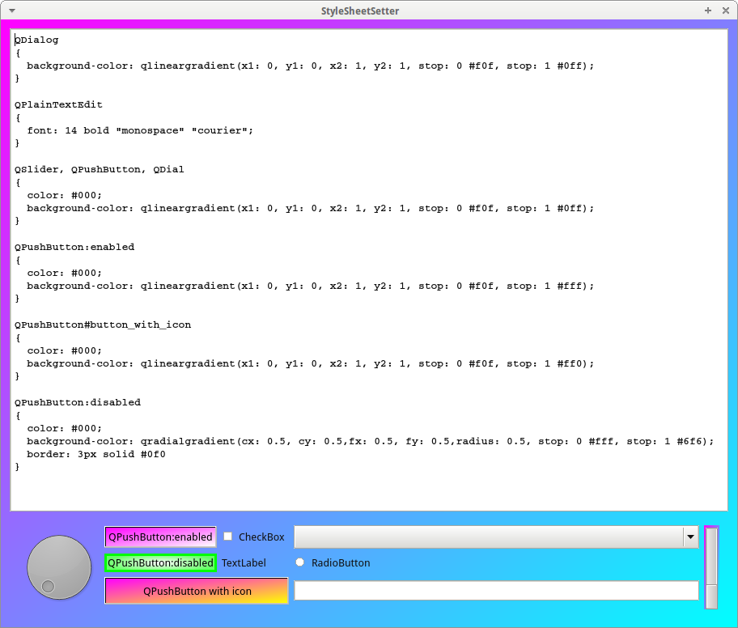

# StyleSheetSetter

Edit the stylesheet of an application.

StyleSheetSetter is one of [Richèl Bilderbeek's
tools](https://richelbilderbeek.github.io/tools/).

## Links

- [Source code](https://github.com/richelbilderbeek/StyleSheetSetter)
- [Richèl Bilderbeek's tools](https://richelbilderbeek.github.io/tools/)
